# TP1-DAR2026 : Sockets en mode connecté TCP

**Nom :** Nour SAIDANI  
**Classe :** LSI 3  
**Matière :** Développement d'applications réparties

# Activité 1-1 : Première connexion Client/Serveur

## Vérification de Git et de Java

Description : la commande `git --version` affiche la version de Git installée, ce qui confirme que Git est bien installé.

Description : Java 8 ne reconnaît pas `--version`, j'ai donc utilisé `java -version`. Java 1.8.0_471 est installé.

## Serveur

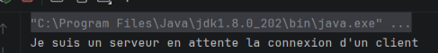

Le serveur a créé un ServerSocket sur le port 1234 et affiche son message d'attente. Il reste bloqué sur la méthode accept() tant qu'aucun client ne se connecte.

## Client

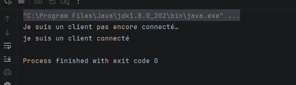
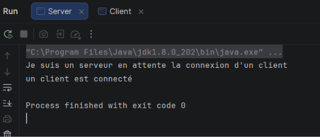

Le client a créé un socket vers localhost sur le port 1234. La connexion TCP a été établie : le client affiche qu'il est connecté, et la méthode accept() du serveur s'est débloquée, affichant « un client est connecté ». Les deux sockets sont ensuite fermés.

### Test avec une adresse IP

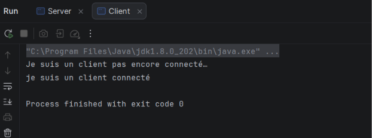
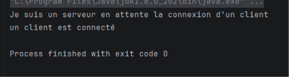

localhost est le nom symbolique de l'adresse de bouclage 127.0.0.1. Le résultat est identique, la connexion fonctionne de la même façon.

# Activité 1-2 : Service de calculatrice
# Activité 1-2 : Service de calculatrice

## Étape 2 : Service de multiplication par 5

### Première version (points 1 à 3)

**Code du serveur :**

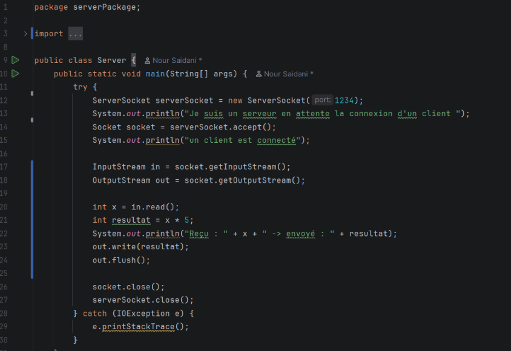

```java
package serverPackage;

import java.io.IOException;
import java.io.InputStream;
import java.io.OutputStream;
import java.net.ServerSocket;
import java.net.Socket;

public class Server {
    public static void main(String[] args) {
        try {
            ServerSocket serverSocket = new ServerSocket(1234);
            System.out.println("Je suis un serveur en attente la connexion d'un client ");
            Socket socket = serverSocket.accept();
            System.out.println("un client est connecté");

            InputStream in = socket.getInputStream();
            OutputStream out = socket.getOutputStream();

            int x = in.read();
            int resultat = x * 5;
            System.out.println("Reçu : " + x + " -> envoyé : " + resultat);
            out.write(resultat);
            out.flush();

            socket.close();
            serverSocket.close();
        } catch (IOException e) {
            e.printStackTrace();
        }
    }
}
```

**Code du client :**

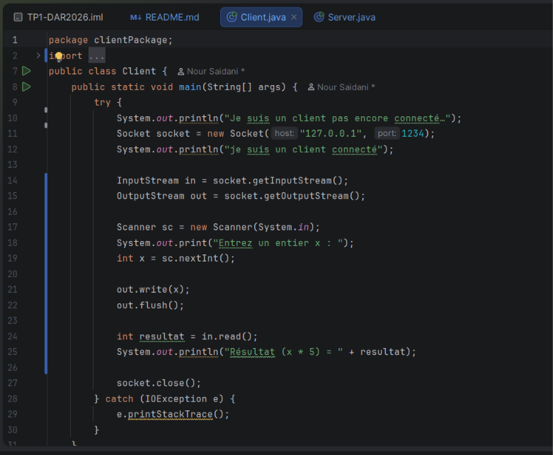

```java
package clientPackage;

import java.io.IOException;
import java.io.InputStream;
import java.io.OutputStream;
import java.net.Socket;
import java.util.Scanner;

public class Client {
    public static void main(String[] args) {
        try {
            System.out.println("Je suis un client pas encore connecté…");
            Socket socket = new Socket("127.0.0.1", 1234);
            System.out.println("je suis un client connecté");

            InputStream in = socket.getInputStream();
            OutputStream out = socket.getOutputStream();

            Scanner sc = new Scanner(System.in);
            System.out.print("Entrez un entier x : ");
            int x = sc.nextInt();

            out.write(x);
            out.flush();

            int resultat = in.read();
            System.out.println("Résultat (x * 5) = " + resultat);

            socket.close();
        } catch (IOException e) {
            e.printStackTrace();
        }
    }
}
```

**Test avec x = 7 :**

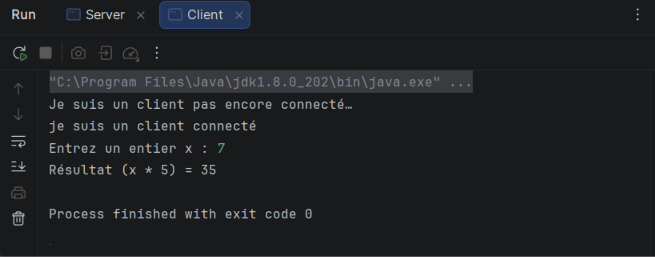

**Test avec x = -4 :**

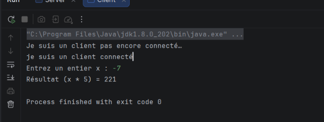

**Test avec x = 0 :**

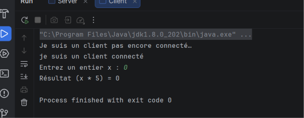

**Interprétation :** pour x = 7, le serveur renvoie 35, et pour x = 0 il renvoie 0 : ces résultats sont corrects. Pour x =


# Activité 1-3 : Amélioration du service de calculatrice

## Étape 1 : Connexion Client/Serveur avec l'adresse IP réelle

### Adresse IP de la machine
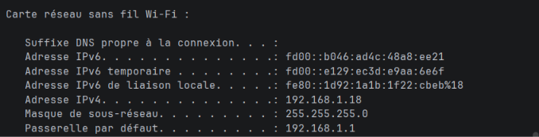

La commande `ipconfig` donne l'adresse IPv4 de la machine : **192.168.1.10**. Cette adresse est utilisée à la place de `localhost`.

### Code du serveur
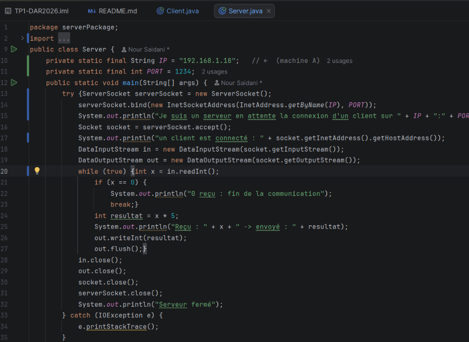

### Code du client
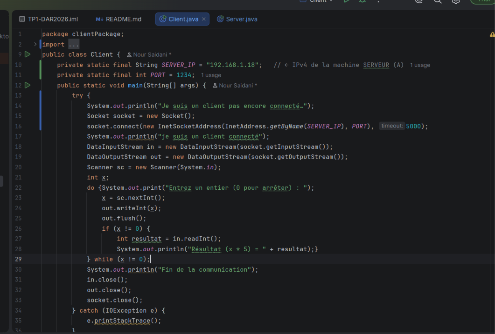


### Résultat côté serveur
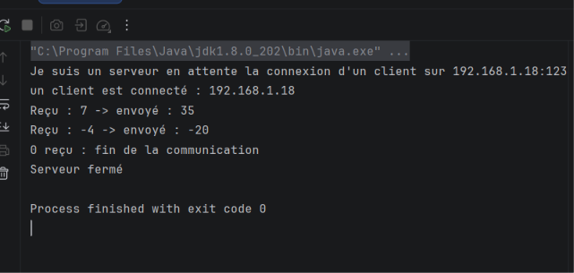

### Résultat côté client
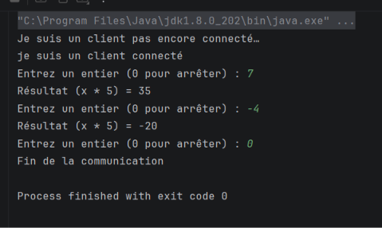

### Interprétation
- Côté serveur, `InetAddress.getByName` transforme l'adresse IP en objet adresse, et `InetSocketAddress` regroupe cette adresse et le port 1234. La méthode `bind()` lie le `ServerSocket` à cette adresse : le serveur écoute sur l'adresse IP réelle de la machine et non plus sur `localhost`.
- Côté client, `localhost` est remplacé par l'adresse IP du serveur, avec le même port, grâce à `InetSocketAddress` et à la méthode `connect()` (délai maximal de 5 secondes).
- La console du serveur affiche « un client est connecté » suivi de l'adresse IP du client : la connexion TCP est établie.
- Les valeurs 7 et -4 donnent 35 et -20, et la saisie de 0 ferme proprement les deux applications.

### Remarque
Faute de deuxième machine disponible, le test a été réalisé sur une seule machine, avec l'adresse IP réelle du réseau local et non `localhost`. Pour un test sur deux machines distinctes du même réseau, il suffit d'exécuter le client sur une autre machine en mettant l'adresse IP du serveur dans `SERVER_IP`, sans autre modification du code.